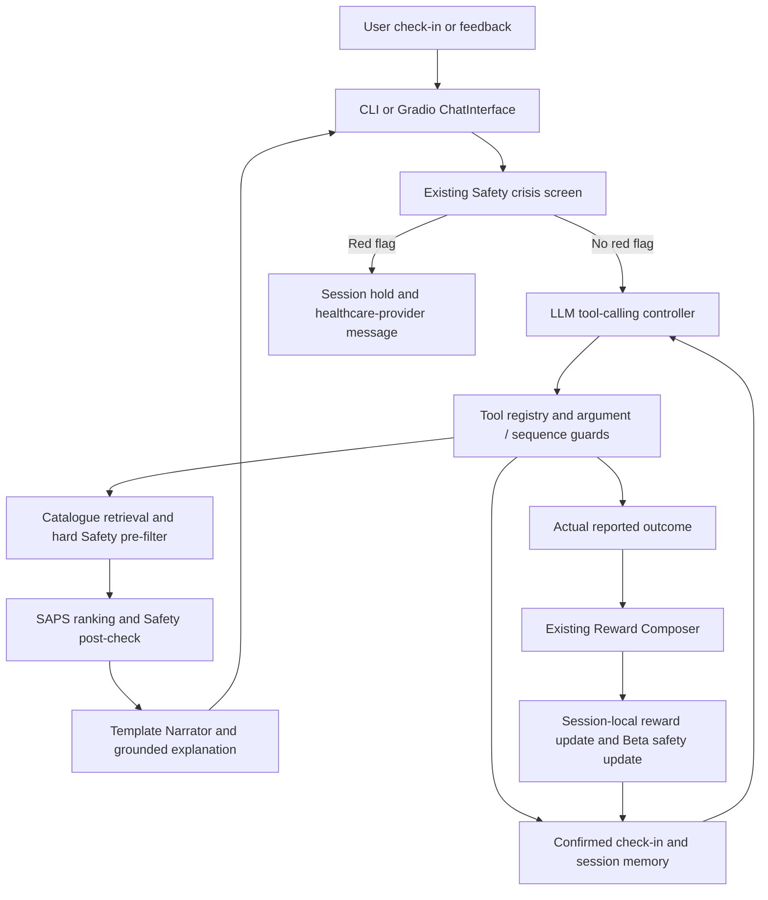

# Conversational NarraCare agent

The new entry points add an **LLM-controlled, tool-using recommender agent** to the existing benchmark. They use OpenAI-compatible tool calling, default model `gpt-4o-mini`. The model interprets English and chooses tools. Python tools enforce valid state, catalogue membership, hard filtering, action order and feedback provenance. The template Narrator renders the recommendation and daily closing. Free-form model text is not an approved exercise plan.

This is a coursework prototype using synthetic profiles, not a validated patient-care service. ACL reconstruction and rotator-cuff repair profiles are postoperative. BP profiles are **chronic lower-back pain**, with no surgery date. The app does not change that distinction or infer a new diagnosis or rehabilitation stage.

## Run the live agent

From the repository root, using Python 3.10+ and an isolated virtual environment:

```bash
python -m pip install -r requirements.txt
python -m pip install -r requirements-agent.txt
```

Set `OPENAI_API_KEY` securely in your shell/environment settings. In the cloud onboarding environment use `NARRACARE_LLM_API_KEY`, since `OPENAI_` names are reserved for platform-managed secret declarations. Do not put the key in source, a transcript, a screenshot or a shell command committed to Git.

Optional nonsecret configuration:

```bash
export NARRACARE_LLM_MODEL=gpt-4o-mini
export NARRACARE_LLM_BASE_URL=https://api.openai.com/v1
python -m narracare.agent --user U001 --seed 42
python -m narracare.agent_app --port 7860
```

Open the local URL printed by Gradio on your own computer. The server binds to loopback, with `share=False`. Do not expose it publicly with a shared API key. UI dependencies are separate; benchmark `requirements.txt` remains unchanged. The GUI loads without a key, but chat reports **LLM not connected** and does not substitute a deterministic agent. The CLI exits 1 without a key. Optional CLI `--transcript /tmp/new-agent-session.json` explicitly saves a new file outside the repository; otherwise state stays in RAM. Quit with `quit` or Ctrl+C.

The live agent requires network access and provider credentials. Existing `python -m narracare.demo` and `demo/index.html` remain offline and retain their previous semantics. The HTML file is recorded replay. The new Gradio app executes live tools and does **not** load its recommendations or outcomes from the HTML trajectories.

## Architecture



`narracare/conversation/controller.py` runs at most ten sequential tool decisions per user turn. Every provider response must contain exactly one tool call. Intermediate results become `role=tool` messages for the next LLM decision. Terminal tools produce the displayed response. A rejected call returns a structured error to the model, which can clarify or correct the request, not bypass the guard. Provider failure produces a visible unavailable message. No hidden reasoning text is logged or shown.

`llm.py` implements the OpenAI-compatible `/chat/completions` protocol without modifying the old OpenAI integration. Credentials go only to the configured HTTPS endpoint. Redirects are rejected. Errors do not print response bodies or credentials. A turn lock prevents concurrent mutation of one conversation; each Gradio session owns its own state, model and RNG instances.

## Assignment Section 4 capabilities

The assignment describes these as examples, not mandatory steps or a guaranteed agent grading bonus. This implementation deliberately supports all eight within its bounded domain.

| Capability | Implemented path | Evidence to inspect |
|---|---|---|
| Understand a natural-language request | The real LLM selects `update_checkin`, `set_preferences`, clarification or feedback tools. Explicit numbers and quoted evidence guard extraction. | `controller.py`, `llm.py`, `SessionTools.update_checkin` |
| Retrieve relevant items | Catalogue retrieval uses condition/body part, actual pre-filter results, explicit avoidances and category preference. | `retrieve_candidates` |
| Maintain preferences | Session-local preferred/avoided categories and `UserMemory` profile updates persist across turns. | `set_preferences`, `snapshot` |
| Ask clarification | Missing, contradictory or invalid symptom ratings and missing outcome fields lead to clarification tools. Ranking without complete state is rejected. | `ask_clarification`, `missing`, rejected-tool activity |
| Rank candidates | Existing `RecommenderAgent` / SAPS receives the retrieved set and a 15-dimensional context. Existing Safety `post_check` then validates the shortlist. | `rank_candidates` |
| Generate personalized recommendations | The validated top item and template Narrator use the selected synthetic profile, current state and narrative day. | `present_recommendation` |
| Explain recommendations | The response exposes task ID, category, body part, difficulty, real candidate counts, preference handling and composite S. | `explain_recommendation`, `explanation` |
| Adapt from feedback | Actual completion/partial outcome updates the existing reward model, per-task Beta safety posterior and user interaction memory. A revised preference changes the actual candidate set. | `record_feedback`, `revise_plan`; regression tests |

The LLM controls which tool to call; it cannot write profile contraindications, medical stage or task definitions. Category matching is structured catalogue retrieval, not embedding/RAG retrieval. Explanations describe the actual selection path, not a causal decomposition of private score terms. Composite S is not a clinical probability. Preference narrowing is explicitly an agent-layer adaptation, not the unchanged benchmark protocol.

## Live tool contracts

1. `update_checkin` accepts explicitly reported **pain, fatigue, mood (0–10)** and **ROM (0–180 degrees)**. Numeric evidence must appear beside its symptom label in the current user message. Missing ratings remain unknown. Qualitative soreness alone is insufficient for a numeric rating.
2. Explicit `ROM unknown` is retained as `null`. Filtering and feature construction use a conservative **0-degree proxy**, clearly flagged in tool output and the explanation. It is not a measured value and must not be reported as patient improvement.
3. `set_preferences` updates category preferences/avoidances from quoted user input. It invalidates a stale ranking. Existing profile dislikes are not treated as medical contraindications.
4. `retrieve_candidates` calls the existing five-rule `pre_filter`, restricts body part to the profile's condition or full body, excludes explicit avoidances, then narrows to preferred categories if such feasible items exist. If none match a **soft preference**, other feasible relevant categories remain available; safety/body-part/avoidance restrictions are never relaxed. Actual counts and whether preferences matched are returned.
5. `rank_candidates` requires a current retrieval. It calls the existing SAPS implementation, checks canonical catalogue membership and real score values, runs `post_check` and a final `pre_filter`. It never restores rejected candidates as a fallback. Empty output means abstention.
6. `present_recommendation` runs final validation and template rendering once, and marks a pending task. `revise_plan` can discard an explicitly rejected/unperformed proposal without inventing a reward or advancing the day. Replanning then requires retrieval/ranking again.
7. `record_feedback` requires explicit completed/partial status plus actual after-pain, after-fatigue and satisfaction (0–1). It computes reward with `UserSimulator.compute_reward`, calls the existing model's reward update and `update_safety(pain_change <= SAPS_PAIN_SAFE_THRESHOLD)`, and records the interaction once. It never calls `simulate_daily_state`, `simulate_choice` or `simulate_feedback`. The current outcome determines the closing; a fresh check-in is required next day. The reward formula's task fit/category terms are computed proxies, not new patient reports.
8. `rest_today` records an explicit skip, renders a campsite/closing and advances narrative day without trail progress. Reward is **unobserved (`null`)**, with no reward or Beta update. The memory record's numeric zero is a bookkeeping placeholder for a skipped interaction, not an observed outcome reward. Intention such as “I'll try” does not establish completion.

The live path replaces the benchmark's behavioral User Simulator with actual user input. It reuses the Simulator's **Reward Composer function only**, rather than claiming a real user is simulated. The other reused components are understanding/context, memory, SAPS, Safety and the template Narrator.

## Companion adventure

Gradio uses the requested **ChatInterface plus right-hand state panel**. Forest (days 1–15), Canyon (16–40) and Summit (41–60) use a one-based narrative day. The new adapter maps the existing profile condition to authored arc keys solely for the new Narrator calls. It does not change benchmark day indexing or data. Starting at a later narrative day creates no synthetic history, clinical stage promotion or earned achievements.

Pip scouts, walks alongside or steps back with the act. Pain/fatigue affect presentation and actual filtering; high mood changes the companion reaction. An explicit skip creates camp. Trail progress and collectibles derive from recorded session actions, not prerecorded acceptance. The reward curve sums actual computed feedback rewards, holding its value on unobserved skip days. The quick reply buttons only fill the message box, so the user can edit and submit deliberately. “I'll try” requests feedback instructions instead of awarding completion.

The right panel shows current/last reported symptoms with freshness labels, profile/stage, preferences, actual task details, candidate counts, narrator tone, reward history and observed tool activity. It contains no model chain of thought. The story is a presentation design intended to make small achievements and rest understandable; reduced fatigue, empathy or adherence benefits require user evaluation.

## Isolation from benchmark evidence

No changes are needed in `src/`, `evaluation/`, `configs/`, `scripts/`, `data/`, `narracare/demo.py`, `narracare/__main__.py`, `narracare/__init__.py` or `demo/index.html`. Components are composed directly. No benchmark pipeline rollout is invoked, and no result directory, config symlink or monkey patch is used. Session-local models are new learners, not pretrained benchmark posteriors. Their scores/rewards must not be compared as if they were the 20-user benchmark results.

New code and optional requirements are separate from the benchmark. The agent has its own interaction tests. A nonsecret environment template is `docs/agent.env.example`; use actual environment settings for secrets. Clinical contraindications and stage come from the selected synthetic profile and remain fixed. A future real patient profile would need approved input and clinical review.

## Rehearsal dialogue

Use a configured LLM and send these messages separately. Model wording/tool order can vary; the guards and assertions below must still hold.

```text
Hello Pip. I would like a manageable exercise today.
My pain is 3, fatigue 2, mood 7 and ROM 110. I prefer flexibility.
Why did you choose this exercise?
I prefer balance instead; avoid flexibility.
I'll try the proposed task. What feedback do you need?
Completed. After pain 3, fatigue 3, satisfaction 0.8.
Skip today and rest.
```

Check that the first turn asks for missing fields, that preference revision changes actual retrieval, that intention causes no reward, that explicit completion updates the reward/Beta/memory once, and that skip causes camp without fabricated feedback. A separate “sudden sharp pain” scenario must stop before any LLM call and put the session on hold.

## Verification and limits

```bash
python -m pytest -q
python -m narracare.agent --help
python -m narracare.agent_app --port 7860
```

`tests/test_conversation.py` uses an explicit **ScriptedPlanner test double** and actual component calls to test the protocol, filtering, feedback, preference revision, narrative boundary adapters, provider errors and isolation. It does not establish that a real model extracts arbitrary English correctly. `tests/test_agent_ui.py` exercises the real Gradio HTTP/session interface with an injected planner when optional dependencies are installed. The test planner is not exposed by either production entry point.

`python -m narracare.agent_check` performs a **real provider smoke scenario** using synthetic data, validates the resulting tool effects and prints assertions. It requires a key, network and provider billing; it never silently skips or uses a fixture. A successful scripted/local UI test must not be reported as a successful live LLM test. Inspect live results before presentation.

LLM extraction may misunderstand or omit facts. Quote/range/sequence guards reduce obvious fabrication but do not prove semantic understanding or clinical safety. Keyword crisis screening has false positives (including negated phrases) and can miss concerns. All five predicates are implementation constraints, not a complete clinical guideline engine. No conversational effectiveness, adherence gain or clinical outcome claim follows from these engineering tests. No blanket guarantee of tool order or deterministic LLM output is made.

## Verified cloud run

On 17 October 2026 (Singapore time), the configured `gpt-4o-mini` provider passed all eight real smoke cases: clarification, retrieval/ranking/template narration, grounded explanation, preference revision, intention-versus-completion, reported feedback updates, camp without invented reward, and red-flag hold. A first live run exposed an unhelpful rejection message during preference revision; the valid `revise_plan` recovery route is now explicit, with a regression test. This changes the new orchestration hints, not the safety rules.

The production Gradio app also passed a real browser dialogue with no page errors. In that run, clarification took 3.407 seconds, recommendation 4.868 seconds and explanation 0.853 seconds. These are individual observations, not latency guarantees. The full test suite passed 67 tests (with five dependency deprecation warnings). All 91 protected source/data/config/script/evaluation files, including 36 result files, matched their pre-agent checksums; the legacy demo entry points and benchmark requirements were unchanged. These engineering checks do not establish clinical or conversational effectiveness.

If pytest is not already installed, install it separately before running the verification commands: `python -m pip install pytest`.
